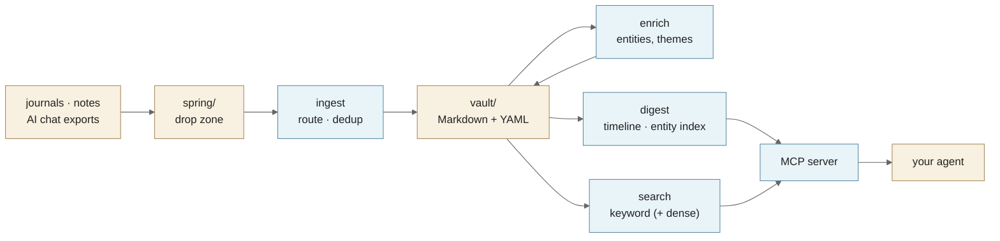

# Memosyne — personal memory for AI agents

[繁體中文](README.zh.md)

> *Mnemosyne (Μνημοσύνη) — Titaness of Memory, mother of the Nine Muses.*
> *Those who drink from her spring remember everything; those who drink from Lethe forget all.*

Memosyne keeps your memories — journals, notes, AI conversations, a profile
of who you are — as **plain Markdown on your own disk**, and lets any AI
agent read them through MCP.

Models get better every quarter, but none of them can know *you* from a cold
start. A vault you build today is portable to every model that comes next.

- **Local-first.** Your vault is a folder of `.md` files. `cat` works. So does `git`.
- **Light by default.** The core is a few small packages (about 75 MB installed) and needs no GPU, no vector database and no LLM.
- **Honest about memory.** Enrichment records only what the source text literally says.

---

## Quick start

```bash
git clone https://github.com/pppeterlin/Memosyne && cd Memosyne
pip install -e .              # core only; Python 3.10+
memosyne quickstart           # end-to-end demo on a synthetic sample vault
```

Then point it at your own life:

```bash
memosyne init                         # creates spring/ and vault/
cp my_journal.md spring/              # .md, .txt, Apple Pages, Gemini exports
memosyne ingest                       # route → enrich → index → digest
memosyne search "what was I thinking about last March?"
memosyne digest --print timeline      # the whole vault at a glance
```

Give your agent access (Claude Desktop, Claude Code, Cursor, …):

```bash
memosyne mcp --print-config           # paste the snippet into your MCP client
```

Enrichment needs one LLM backend — a local Ollama, or a cloud key such as
DeepSeek or OpenRouter. `memosyne providers list` shows what is ready, and
`memosyne ingest --no-enrich` skips it entirely.

---

## How it works



The Markdown files are the source of truth. Every index is derived and can
be rebuilt from them.

### Three layers — install only what you use

| Layer | Install | Adds |
|---|---|---|
| **core** | `pip install -e .` | ingest, enrichment, digests, keyword search, MCP server |
| **search** | `pip install -e ".[search]"` | dense vector retrieval (~1 GB: torch + ChromaDB) |
| **labs** | `pip install -e ".[labs]"` | entity graph, ACT-R reranking, consolidation, audit, corrections, RAG chat |

Details in [docs/architecture.md](docs/architecture.md).

---

## What an agent can do with it

The MCP server exposes nine tools by default:

| Tool | Use it for |
|---|---|
| `get_profile(section)` | who the user is — read this first |
| `get_digest(kind, year)` | the whole picture: a timeline, or every place / person / event and where it appears |
| `search_memory(query, top_k, include_chats)` | finding specific memories |
| `list_journals(year, limit)` · `read_file(path)` | browsing and reading the originals |
| `muse_call()` · `muse_answer(id, answer)` | asking the user about gaps in the vault |
| `get_memory_health()` · `memosyne_guide(situation)` | usage stats; which tool fits a situation |

**Search finds; the digest surveys.** Top-k retrieval cannot answer "where
have I travelled?" or "what happened in what order?" — those need
everything, not the five nearest chunks. `memosyne digest` builds two small
files from memory frontmatter, deterministically and without an LLM, so an
agent can read the whole shape of a life in one call.

AI chat transcripts are searched only on request (`include_chats`): they are
usually far larger than the rest of the vault and mostly not about you.

---

## A memory

```yaml
---
title: "Tokyo Slow 第二集邀約"
date: 2026-02-03
type: journal
# ── Enrichment (only entities that literally appear in the text) ──
enriched_at: "2026-02-04T09:00:00"
importance: high
period: "2026 冬季接案期"
themes: ["旅行", "工作"]
entities:
  locations: ["東京", "冰島"]
  people: ["Aiko", "Ravi", "Wei"]
  events: ["《Tokyo Slow》第二集的合作"]
---

Aiko 從東京傳訊息問我願不願意接《Tokyo Slow》第二集的合作……
```

**Ground-truth preserving:** every extracted entity is checked against the
original string. No inference, no hallucinated facts in your memory.

The vault is organised by kind of memory:

```
vault/
├── 10_Profile/     who you are (hand-written, plus optional aggregates)
├── 20_AI_Chats/    conversations with AI assistants
├── 30_Journal/     life as it happened
├── 40_Projects/    what you are building
├── 50_Knowledge/   what you have learned
└── _digest/        generated timeline + entity index
```

---

## Why the default is small

Earlier versions ran every query through a graph database, Personalized
PageRank, a backlink boost, ACT-R reranking and a domain router. In 1.5 we
measured each stage on a real vault (≈200 journal entries, ≈450 AI chats;
questions about journal entries, n = 125):

| Search path | Recall@1 | Recall@5 | Recall@10 | Latency |
|---|---:|---:|---:|---:|
| **dense + BM25 (1.5 default)** | **0.57** | **0.79** | **0.83** | **1×** |
| BM25 only (core install) | 0.57 | 0.72 | 0.78 | 0.7× |
| + graph search | 0.38 | 0.68 | 0.82 | 2× |
| + PPR, backlink boost, ACT-R, routing (1.0 default) | 0.26 | 0.60 | 0.81 | 6× |

The simple path finds the right memory first twice as often. The other
stages target multi-hop and recency questions that this benchmark does not
measure, so they are still available — as opt-in
[`memosyne.labs`](docs/architecture.md) features
(`MEMOSYNE_SEARCH_PROFILE=full`), not as a cost every user pays. Method and
caveats: [docs/evaluation.md](docs/evaluation.md#ablation-v15).

---

## Privacy

- Nothing leaves your machine unless you configure a cloud LLM or embedding
  provider. Keyword search, digests, gap questions and the MCP server are fully offline.
- Your vault is never part of this repository. Keep it anywhere; back it up
  to a **private** repository if you like.
- The sample vault under `sample_vault/` is entirely synthetic.

More in [docs/privacy.md](docs/privacy.md).

---

## Glossary — mythology ↔ engineering

File and function names say what the code does. The mythology survives
where a person meets the system — commands and messages.

| You will see | It means |
|---|---|
| **The Spring** (`spring/`) | drop zone for files waiting to be ingested |
| **The Vault** | your Markdown memories |
| **The Oracle** | the LLM enrichment step |
| **The Muses** · **The Call of the Muses** | memory domains · daily gap questions (`memosyne call`) |
| **The Chronicle of Mneme** | access log (`memosyne chronicle`) |
| **The Tapestry** | entity graph (`memosyne tapestry`, labs) |
| **The Rite of Slumber** | consolidation: reflection, Hebbian links, dormancy (`memosyne slumber`, labs) |
| **The Augury** · **Aletheia** | memory audit · audited corrections (labs) |
| **Lethe** | forgetting — dormant memories are hidden, never deleted |

---

## Documentation

| | |
|---|---|
| [architecture.md](docs/architecture.md) | layers, paths, module map |
| [configuration.md](docs/configuration.md) | every environment variable |
| [mcp.md](docs/mcp.md) | MCP setup, HTTP transport, tool reference |
| [operations.md](docs/operations.md) | daily use and troubleshooting |
| [evaluation.md](docs/evaluation.md) | measuring retrieval; the 1.5 ablation |
| [privacy.md](docs/privacy.md) | what stays local, what a provider sees |
| [migration_v1.5.md](docs/migration_v1.5.md) | upgrading an existing checkout |
| [development.md](docs/development.md) | contributing, tests, releases |
| [references.md](docs/references.md) | research and libraries this builds on |

Roadmap: [ROADMAP.md](ROADMAP.md) · Changes: [CHANGELOG.md](CHANGELOG.md)

## License

[MIT](LICENSE)

---

*Built with a mythological worldview — because memory deserves ceremony.*
