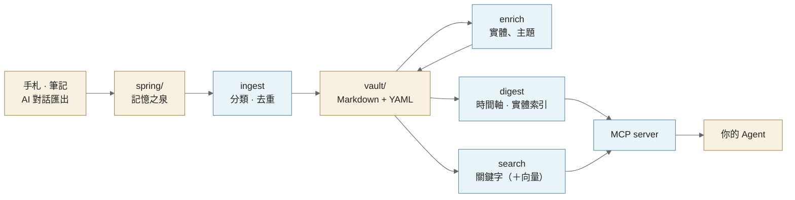

# Memosyne — 給 AI Agent 的個人記憶庫

[English](README.md)

> *Mnemosyne (Μνημοσύνη) — 泰坦記憶女神，九位繆思之母。*
> *飲她聖泉的人記得一切；飲忘川之水的人遺忘所有。*

Memosyne 把你的記憶（手札、筆記、AI 對話、關於你是誰的 Profile）存成**你自己硬碟上的純 Markdown**，並透過 MCP 讓任何 AI Agent 讀取。

模型每一季都在變強，但沒有任何模型能從零開始認識*你*。今天建立的記憶庫，可以原封不動帶到下一個模型。

- **本地優先。** 記憶庫就是一個放 `.md` 檔的資料夾，`cat` 看得懂，`git` 管得動。
- **預設輕量。** 核心只有幾個小套件（安裝後約 75 MB），不需要 GPU、向量資料庫或 LLM。
- **對記憶誠實。** 語意增強只記錄原文字面上出現的內容。

---

## 快速開始

```bash
git clone https://github.com/pppeterlin/Memosyne && cd Memosyne
pip install -e .              # 只裝核心；Python 3.10+
memosyne quickstart           # 用合成的 sample vault 跑一次完整流程
```

接著換成你自己的生活：

```bash
memosyne init                         # 建立 spring/ 與 vault/
cp 我的手札.md spring/                # 支援 .md、.txt、Apple Pages、Gemini 匯出
memosyne ingest                       # 分類 → 增強 → 索引 → 彙整
memosyne search "去年三月我在想什麼？"
memosyne digest --print timeline      # 一眼看完整個記憶庫
```

讓你的 Agent 連上來（Claude Desktop、Claude Code、Cursor…）：

```bash
memosyne mcp --print-config           # 把輸出貼進 MCP client 設定
```

語意增強需要一個 LLM 後端：本機 Ollama，或 DeepSeek、OpenRouter 等雲端金鑰。`memosyne providers list` 會列出目前可用的；`memosyne ingest --no-enrich` 可以完全跳過。

---

## 運作方式



Markdown 檔是唯一的事實來源，所有索引都是衍生物，隨時可以重建。

### 三層架構：用到什麼才裝什麼

| 層 | 安裝 | 提供 |
|---|---|---|
| **core** | `pip install -e .` | 入庫、語意增強、彙整、關鍵字搜尋、MCP server |
| **search** | `pip install -e ".[search]"` | 向量檢索（約 1 GB：torch + ChromaDB） |
| **labs** | `pip install -e ".[labs]"` | 實體圖譜、ACT-R 重排、記憶鞏固、審計、更正、RAG 對話 |

詳見 [docs/architecture.md](docs/architecture.md)。

---

## Agent 可以用它做什麼

MCP server 預設提供九個工具：

| 工具 | 用途 |
|---|---|
| `get_profile(section)` | 使用者是誰——先讀這個 |
| `get_digest(kind, year)` | 全貌：時間軸，或所有地點／人物／事件各自出現在哪些記憶 |
| `search_memory(query, top_k, include_chats)` | 找特定記憶 |
| `list_journals(year, limit)` · `read_file(path)` | 瀏覽與閱讀原文 |
| `muse_call()` · `muse_answer(id, answer)` | 針對記憶庫的缺口向使用者提問 |
| `get_memory_health()` · `memosyne_guide(situation)` | 使用統計；判斷該用哪個工具 |

**搜尋用來找，彙整用來看全貌。** 「我去過哪些地方」「事情的先後順序」這類問題，top-k 檢索回答不了，因為需要的是全部，不是最接近的五個片段。`memosyne digest` 從記憶的 frontmatter 決定性地生成兩個小檔案（不經過 LLM），讓 Agent 一次呼叫就能讀到整段人生的輪廓。

AI 對話紀錄只在明確要求時才納入搜尋（`include_chats`）：它們通常比其餘記憶大上一個量級，而且多半與你本人無關。

---

## 一則記憶長這樣

```yaml
---
title: "Tokyo Slow 第二集邀約"
date: 2026-02-03
type: journal
# ── Enrichment（僅含原文出現的實體）──
enriched_at: "2026-02-04T09:00:00"
importance: high
period: "2026 冬季接案期"
themes: ["旅行", "工作"]
entities:
  locations: ["東京", "冰島"]
  people: ["Aiko", "Ravi", "Wei"]
  events: ["《Tokyo Slow》第二集的合作"]
---

Aiko 從東京傳訊息問我願不願意接《Tokyo Slow》第二集的合作……
```

**Ground-truth preserving：** 每個抽出的實體都會與原文字串比對。不推論、不幻想，記憶裡不會出現原文沒有的事實。

記憶庫依記憶的種類分區：

```
vault/
├── 10_Profile/     你是誰（手寫，另有選用的彙整檔）
├── 20_AI_Chats/    與 AI 助理的對話
├── 30_Journal/     生活的紀錄
├── 40_Projects/    你正在做的事
├── 50_Knowledge/   你學到的東西
└── _digest/        自動生成的時間軸與實體索引
```

---

## 為什麼預設這麼精簡

先前的版本讓每次查詢都經過圖資料庫、Personalized PageRank、backlink 加權、ACT-R 重排與領域路由。1.5 在一個真實記憶庫上逐層量測（約 200 篇手札、約 450 篇 AI 對話；針對手札的提問，n = 125）：

| 檢索路徑 | Recall@1 | Recall@5 | Recall@10 | 延遲 |
|---|---:|---:|---:|---:|
| **dense + BM25（1.5 預設）** | **0.57** | **0.79** | **0.83** | **1×** |
| 只有 BM25（核心安裝） | 0.57 | 0.72 | 0.78 | 0.7× |
| ＋圖譜搜尋 | 0.38 | 0.68 | 0.82 | 2× |
| ＋PPR、backlink、ACT-R、路由（1.0 預設） | 0.26 | 0.60 | 0.81 | 6× |

精簡路徑把正確記憶排在第一位的機率是原本的兩倍。其餘階段針對的是多跳與時近性問題，這個評測量不到，所以它們仍然保留，但改為選用的 [`memosyne.labs`](docs/architecture.md) 功能（`MEMOSYNE_SEARCH_PROFILE=full`），不再是每個使用者都要付的成本。方法與限制見 [docs/evaluation.md](docs/evaluation.md#ablation-v15)。

---

## 隱私

- 除非你自己設定雲端 LLM 或 embedding 服務，否則沒有任何資料會離開你的機器。關鍵字搜尋、彙整、缺口提問與 MCP server 都完全離線。
- 你的記憶庫不屬於這個 repo。放在哪裡都可以；要備份請用 **private** repo。
- `sample_vault/` 裡的內容完全是合成的。

詳見 [docs/privacy.md](docs/privacy.md)。

---

## 詞彙對照：神話 ↔ 工程

檔名與函式名直接說明程式在做什麼。神話只保留在人與系統接觸的地方——指令與訊息。

| 你會看到 | 意思 |
|---|---|
| **The Spring**（`spring/`） | 等待入庫的檔案放這裡 |
| **The Vault** | 你的 Markdown 記憶 |
| **The Oracle** | LLM 語意增強 |
| **The Muses** · **The Call of the Muses** | 記憶領域 · 每日缺口提問（`memosyne call`） |
| **The Chronicle of Mneme** | 存取紀錄（`memosyne chronicle`） |
| **The Tapestry** | 實體圖譜（`memosyne tapestry`，labs） |
| **The Rite of Slumber** | 記憶鞏固：反思、赫布連結、休眠（`memosyne slumber`，labs） |
| **The Augury** · **Aletheia** | 記憶審計 · 可回溯的更正（labs） |
| **Lethe** | 遺忘——休眠的記憶只是隱藏，永不刪除 |

---

## 文件

| | |
|---|---|
| [architecture.md](docs/architecture.md) | 分層、路徑、模組對照 |
| [configuration.md](docs/configuration.md) | 所有環境變數 |
| [mcp.md](docs/mcp.md) | MCP 設定、HTTP transport、工具說明 |
| [operations.md](docs/operations.md) | 日常操作與疑難排解 |
| [evaluation.md](docs/evaluation.md) | 檢索評估與 1.5 的 ablation |
| [privacy.md](docs/privacy.md) | 哪些留在本機、服務商看得到什麼 |
| [migration_v1.5.md](docs/migration_v1.5.md) | 從舊版升級 |
| [development.md](docs/development.md) | 貢獻、測試、發版 |
| [references.md](docs/references.md) | 參考的研究與函式庫 |

路線圖：[ROADMAP.md](ROADMAP.md) · 變更紀錄：[CHANGELOG.md](CHANGELOG.md)

## 授權

[MIT](LICENSE)

---

*以神話世界觀打造——因為記憶值得一點儀式感。*
