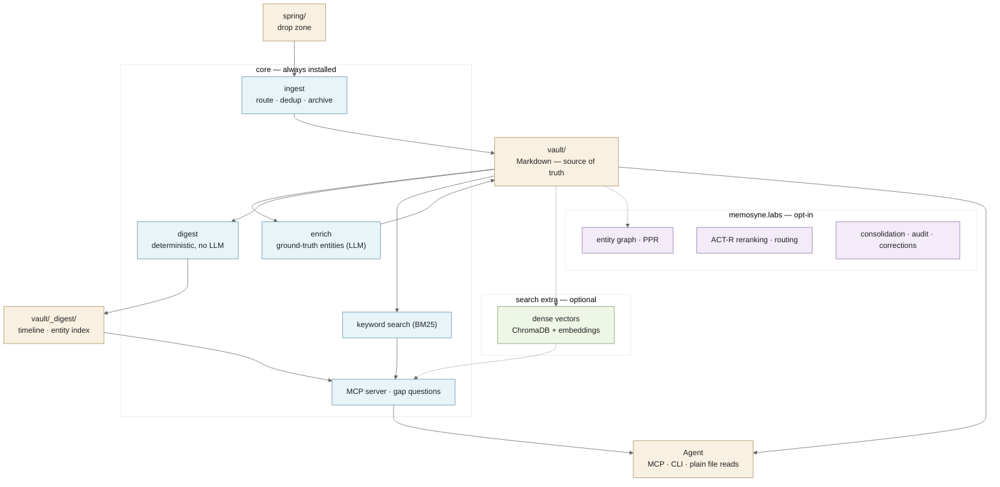

# Architecture

Memosyne has one job: keep a person's memories as plain Markdown that any
AI agent can read, today and with whatever model comes next.

Everything else is in service of that, and is organised in three layers so
that you only install — and only have to understand — what you use.

## The layers

| Layer | Install | What it gives you | Cost |
|---|---|---|---|
| **core** | `pip install -e .` | ingest, enrichment, digests, keyword search, MCP server, gap questions | a few small packages (~75 MB installed) |
| **search** | `pip install -e ".[search]"` | dense vector retrieval fused with keyword search | ~1 GB (torch, sentence-transformers, ChromaDB) |
| **labs** | `pip install -e ".[labs]"` | entity graph, ACT-R reranking, domain routing, consolidation, audit, corrections, RAG chat | Kuzu, NetworkX, flashrank, … |

The core never imports `memosyne.labs` at module level. Labs stages run only
when you ask for them (`MEMOSYNE_SEARCH_PROFILE=full`, `MEMOSYNE_MCP_TOOLS=all`,
or the labs CLI commands).

### Why the default is small

An ablation on a real vault ([evaluation.md](evaluation.md#ablation-v15))
showed that plain dense + BM25 fusion finds the right journal entry first
more than twice as often as the full pre-1.5 stack, at a sixth of the
latency. The extra stages are designed for multi-hop and recency questions
that the benchmark does not measure, so they are kept — but as opt-in labs
features, not as the default every user pays for.

For the questions top-k retrieval cannot answer at all ("where have I
travelled?", "what happened in what order?"), the **digest** gives agents
the whole picture in two small files instead.

## Where things live

| Location | Default | Override |
|---|---|---|
| home | the source checkout, else the current directory | `MEMOSYNE_HOME` |
| vault | `<home>/vault` | `MEMOSYNE_VAULT_DIR` |
| artifacts | `<vault>/_artifacts` | `MEMOSYNE_ARTIFACT_DIR` |
| spring | `<home>/spring` | `MEMOSYNE_SPRING_DIR` |

`src/memosyne/paths.py` is the only module that decides paths. A memory is
any `.md` file inside a top-level vault folder; files at the vault root and
folders starting with `_` or `.` are never treated as memories.

Pre-1.5 checkouts (`Personal_Brain_DB/_vault`) keep working in place — see
[migration_v1.5.md](migration_v1.5.md).

## Module map

| Module | Layer | Role | Pre-1.5 name |
|---|---|---|---|
| `cli.py` | core | `memosyne` command surface | `memosyne.py` |
| `paths.py` | core | home / vault / artifact resolution | `artifacts.py` |
| `ingest.py` | core | The Spring Ritual: route, dedup, archive | `ingest.py` |
| `pages_reader.py`, `turns.py`, `turn_ledger.py`, `content_hash.py` | core | source parsers and turn-level dedup | same |
| `enrich.py`, `link_extractor.py` | core | ground-truth entity extraction (LLM + deterministic) | same |
| `digest.py` | core | deterministic timeline + entity index | *new in 1.5* |
| `retrieval.py` | core | chunking, index build, hybrid search | `vectorize.py` |
| `temporal_parser.py` | core | time expressions in queries | same |
| `access_log.py` | core | access log (Chronicle) + ACT-R scoring | `mneme_weight.py` |
| `gap_questions.py` | core | The Call of the Muses | `muse_call.py` |
| `mcp_server.py`, `auth.py` | core | MCP server (stdio / HTTP) | same |
| `llm_client.py`, `providers.py` | core | LLM backends | same |
| `embedding.py`, `hf_runtime.py` | search | embedding backends | `embed_backend.py`, `model_env.py` |
| `labs/graph.py` | labs | entity graph (The Tapestry), PPR | `tapestry.py` |
| `labs/routing.py` | labs | domain routing (the Muses) | `muses.py` |
| `labs/consolidate.py` | labs | The Rite of Slumber | `slumber.py` |
| `labs/audit.py` | labs | The Augury | `augury.py` |
| `labs/corrections.py` | labs | Aletheia | `aletheia.py` |
| `labs/query_decompose.py`, `labs/query_log.py` | labs | query planning, capture + replay | same |
| `labs/retrieval_eval.py`, `labs/golden_eval.py`, `labs/compare_configs.py` | labs | evaluation | `benchmark/retrieval_eval.py`, `eval_golden.py`, `quick_verify.py` |
| `labs/chat.py` | labs | RAG chat REPL | `chat.py` |

Removed in 1.5: `process_files.py` and `watch.py` (the pre-`ingest` pipeline),
`search.py` (use `memosyne search`), `probe_mimo.py`,
`backfill_chat_category.py`, `requirements.txt`.

## Naming

File and function names say what the code does. The mythology (Spring,
Vault, Oracle, Muses, Tapestry, Chronicle, Slumber, Augury, Aletheia) is
kept where a person meets the system — CLI verbs, output messages and the
glossary in the README — because memory deserves a little ceremony.
